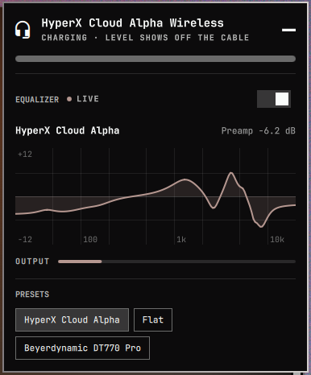

# omabateq

**Headset battery + equalizer for the [Omarchy](https://omarchy.org) bar.**

A bar widget that shows your wireless headset's battery next to the volume
icon. Click it for a panel with the battery and the live
[Easy Effects](https://github.com/wwmm/easyeffects) equalizer: which preset is
active, the curve it applies, an on/off switch, the output level, and buttons
to switch presets.

<p align="center"></p>

## What it shows

**In the bar:** a headset icon with the battery percentage. It shows a
charging symbol when the headset only reports that it is charging, fades when
the headset is switched off, and disappears when no supported headset or
receiver is plugged in.

**In the panel:**

| Part | What it is |
|---|---|
| Header | Headset name, status (connected / charging / off), battery percentage and bar |
| Equalizer status | **Live** — audio is going through the equalizer right now. **Idle** — Easy Effects is running but nothing is playing. **Bypassed** — switched off |
| Switch | Turns the equalizer on or off (Easy Effects' global bypass). <kbd>Enter</kbd> does the same |
| Preset + preamp | The output preset Easy Effects has loaded, and its preamp |
| Curve | The frequency response of that preset, 20 Hz–20 kHz, ±12 dB. Grey when bypassed |
| Output | Live level reaching your output device, after the equalizer |
| Presets | One button per saved output preset; click to load it |

If Easy Effects isn't running, the panel says so and offers a button to start it.

## How it works

Everything comes from tools that are already on the system; the plugin only
reads and displays it.

- **Battery** — [`headsetcontrol`](https://github.com/Sapd/HeadsetControl)
  talks to the headset over USB HID (through the wireless receiver).
  The plugin runs `headsetcontrol -b -o json` once a minute, every 10 seconds
  while the panel is open.
- **Equalizer state** — [`bin/eq-state`](bin/eq-state) asks Easy Effects
  through its command line for the loaded preset (`easyeffects -a output`),
  the bypass state (`easyeffects -b 3`) and the saved presets
  (`easyeffects -p`). It checks that Easy Effects is running first, because
  those commands would otherwise start it. Polled every 3 seconds while the
  panel is open, since Easy Effects can switch presets by itself when the
  output device changes.
- **The curve** — the active preset's file in
  `~/.local/share/easyeffects/output/` is read and watched, so saving a
  preset in Easy Effects redraws the curve. Each equalizer band (bell,
  low shelf, high shelf) is turned into a biquad filter with the
  [RBJ Audio EQ Cookbook](https://www.w3.org/TR/audio-eq-cookbook/) formulas,
  and the bands' responses are added up at 160 points. The preamp is left out
  so the curve shows the shape of the correction. A quick sanity check: for an
  AutoEQ preset, the curve's highest point matches the preamp AutoEQ chose.
- **Live and output level** — Easy Effects removes its filters from the
  PipeWire graph when nothing is playing, so the plugin shows *Live* when the
  `ee_soe_equalizer` node exists. The output meter is Quickshell's
  `PwNodePeakMonitor` on the default output device.
- **Switch and preset buttons** run `easyeffects -b 1|2` and `easyeffects -l <preset>`.

## Requirements

- Omarchy (the Quickshell-based shell with plugin support)
- [`headsetcontrol`](https://github.com/Sapd/HeadsetControl) with a
  [supported headset](https://github.com/Sapd/HeadsetControl#supported-headsets)
  for the battery
- [Easy Effects](https://github.com/wwmm/easyeffects) 8.x and
  `lsp-plugins-lv2` (its equalizer) for the equalizer part

Tested with a HyperX Cloud Alpha Wireless. Without a supported headset the
widget stays hidden.

## Setup

### 1. Install the tools

```bash
sudo pacman -S headsetcontrol easyeffects lsp-plugins-lv2
```

The `headsetcontrol` package installs udev rules so it works without root.
Unplug and replug the headset's receiver afterwards so they apply, then check:

```bash
headsetcontrol -b
```

> **Wired vs. wireless:** many wireless headsets show up under the same name
> when plugged in to charge. `headsetcontrol` needs the **receiver** (dongle).
> The charging cable usually only carries power and firmware updates.

### 2. Add the plugin

```bash
omarchy plugin add https://github.com/lidoliver/omabateq --enable
```

Pick the `right` section when asked, then move it next to the volume icon:

```bash
omarchy bar move lidoliver.omabateq --before omarchy.audio
```

### 3. Make equalizer presets

The curve is only as good as the preset. For a correction measured for your
headphone model:

1. Find your model on [autoeq.app](https://autoeq.app) and download the
   **Parametric EQ** file (Equalizer APO format).
2. In Easy Effects: **Output → Add effect → Equalizer**, then use the
   equalizer's import button to load the file.
3. Save it as a preset (**Presets → name it → Save**), for example
   `HyperX-Cloud-Alpha`.

AutoEQ presets come with a negative preamp (often around −6 dB), so turn your
volume up a bit to make up for it. It prevents clipping where the curve boosts.

### 4. Optional: one preset per output device

Easy Effects can load a preset automatically when you switch output, e.g.
the headset's EQ on the headset, another on wired headphones, nothing on
speakers. Set it up in **Presets → Autoload**, or as files in
`~/.local/share/easyeffects/autoload/output/`:

```json
{
  "device": "alsa_output.usb-HP__Inc_HyperX_Cloud_Alpha_Wireless_00000001-00.analog-stereo",
  "device-description": "HyperX Cloud Alpha",
  "device-profile": "Analog Output",
  "preset-name": "HyperX-Cloud-Alpha"
}
```

saved as `<device>:<device-profile>.json`. Two things that are easy to get wrong:

- `device-profile` is the **route description** (`Analog Output`,
  `Front Headphones`), not the port name (`analog-output`). Get it with
  `pactl -f json list sinks` → the `description` of the active port.
- Easy Effects has to follow the default output device for this to trigger:
  **Preferences → Use default output** (`useDefaultOutputDevice=true` in
  `~/.config/easyeffects/db/easyeffectsrc`).

### 5. Start Easy Effects at login

Otherwise there is no equalizer until you open it. Create
`~/.config/autostart/easyeffects-service.desktop`:

```ini
[Desktop Entry]
Type=Application
Name=Easy Effects
Exec=easyeffects --service-mode --hide-window
StartupNotify=false
Terminal=false
```

Omarchy runs autostart entries as systemd user services at login.

## Troubleshooting

| Symptom | Cause |
|---|---|
| The widget doesn't appear | `headsetcontrol -b` finds no device. Plug in the receiver, not just the charging cable, and replug it after installing `headsetcontrol` |
| `—` instead of a percentage while charging | Many headsets only report *charging* while on the cable. The level comes back when it's unplugged |
| *Live* but the output meter is still | Something has a stream open but is silent, e.g. Discord's voice stream when nobody is talking |
| Everything is much quieter with the EQ on | That's the preamp. Turn the volume up |
| Easy Effects says the equalizer can't be used | `lsp-plugins-lv2` is missing. Install it and restart Easy Effects (`easyeffects -q`) |
| Autoload never switches presets | Wrong `device-profile` (see step 4), or Easy Effects isn't following the default output |

## Files

```
Panel.qml        the bar button, the panel, and where data comes from
EqCurve.qml      the response plot
LevelBar.qml     the battery bar and the output meter
Model.js         parsing and the filter math, no QML
bin/eq-state     reads Easy Effects' state through its CLI
i18n/en.json     the panel's text
tests/           node tests for Model.js
```

Run the tests with:

```bash
node tests/model.test.js
```

Edit the files in `~/.config/omarchy/plugins/lidoliver.omabateq/` and the
shell reloads the plugin on save.

## License

MIT
